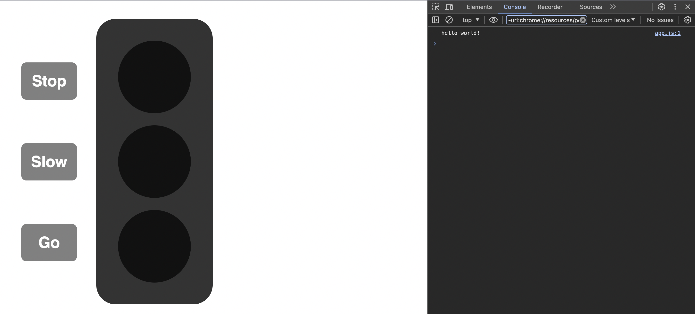

# 

## Setup

Open your Terminal application and navigate to your `~/code/ga/labs` directory:

```bash
cd ~/code/ga/labs
```

Make a new repository on [GitHub](https://github.com/) named javascript-traffic-light-lab.

Clone a copy of your remote repo locally by using the `git clone` command:

```bash
git clone https://github.com/<your-username>/javascript-traffic-light-lab.git
```

> 📚 Note: In the link above, where it says `<your-username>`, you should see the username from your GitHub account.

Next, `cd` into your new cloned directory, `javascript-traffic-light-lab`:

```bash
cd javascript-traffic-light-lab
```

Open the project's folder in your code editor:

```bash
code .
```

Next, create directories for your CSS and JS files:

```bash
mkdir css js
```

Create your HTML, CSS, and JS files:

```bash
touch css/style.css js/app.js index.html
```

### HTML Starter Code

Next, copy the following into your newly created `index.html` file:

```html
<!DOCTYPE html>
<html lang="en">
  <head>
    <meta charset="UTF-8" />
    <meta name="viewport" content="width=device-width, initial-scale=1.0" />
    <!-- Connect your CSS -->
    <link rel="stylesheet" type="text/css" href="./css/style.css" />
    <!-- Connect your JS -->
    <script defer src="./js/app.js"></script>
    <title>Javascript Traffic Light Lab</title>
  </head>
  <body>
    <div id="controlPanel">
      <h1 id="stopButton" class="button">Stop</h1>
      <h1 id="slowButton" class="button">Slow</h1>
      <h1 id="goButton" class="button">Go</h1>
    </div>
    <div id="traffic-light">
      <div id="stopLight" class="bulb"></div>
      <div id="slowLight" class="bulb"></div>
      <div id="goLight" class="bulb"></div>
    </div>
  </body>
</html>
```

This markup provides the underlying structure of our traffic light.

### CSS Starter Code

Copy the following into `css/style.css`:

```css
body {
  font-family: sans-serif;
}

#controlPanel {
  float: left;
  padding-top: 30px;
}

.button {
  background-color: gray;
  color: white;
  border-radius: 10px;
  padding: 20px;
  text-align: center;
  margin: 90px 40px;
  cursor: pointer;
}

#traffic-light {
  height: 550px;
  width: 200px;
  float: left;
  background-color: #333;
  border-radius: 40px;
  margin: 30px 0;
  padding: 20px;
}

.bulb {
  height: 150px;
  width: 150px;
  background-color: #111;
  border-radius: 50%;
  margin: 25px auto;
  transition: background 500ms;
}
```

These styles will shape our markup into something that resembles a traffic light.

### JS Starter Code

Finally, in `js/app.js`, enter the following:

```js
console.log('hello world!');
```

Next, open `index.html` in your web browser. You should see a traffic light. Additionally, open your browser's console (usually accessible by right-clicking the page and selecting "Inspect" or "Inspect Element," then navigating to the "Console" tab). You should see the message `'hello world!'` printed in the console.



At this stage, the traffic light won't respond when you click the buttons. Your task will be to add functionality to the traffic light.

If you don't see the traffic light or the console message, check the following:

- Ensure your directory structure matches what is outlined in the file setup above.
- Verify that all necessary starter code has been copied over correctly from the provided code blocks.

Make any necessary corrections, and try again.
